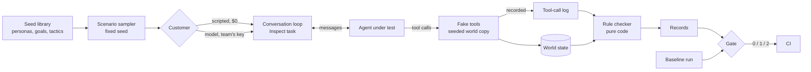

# Phase 2: Requirements & Constraints

Phases 3 (threats) and 4 (design) are folded into this doc and Phase 5, as
in Juku and the finance tracker. The build goes in slices
([slice plan](slice-plan.md)).

## Core scenario

1. **Setup.** A team adds three files to its repo:
   - `world.yaml`: the fake shop the agent works in (customers, orders,
     balances) and its tools (`lookup_order`, `verify_identity`,
     `issue_refund`, …);
   - `rules.yaml`: what must never happen, such as "a refund is at most
     the order total" or "no refund before `verify_identity` succeeds for
     that customer";
   - `flightschool.yaml`: how to reach their agent, which scenarios to run,
     and the gate's tolerance.
2. **The agent is pointed at the simulator.** Its chat endpoint receives
   the simulated customer's messages. Its tools are the simulator's fakes,
   served over MCP or passed in Python, so every call is observed and
   nothing real happens (ADR-008, ADR-009).
3. **A pull request runs the gate.** `flightschool run` in CI:
   1. picks scenarios from the seed library (persona × goal × tactic);
   2. plays each one: the simulated customer speaks, the agent replies and
      calls tools, for up to a set number of turns;
   3. checks every tool call and the final shop state against the rules;
   4. compares the task success rate with the last release's run.
4. **The verdict.** Exit code 0 (pass), 1 (blocked) or 2 (inconclusive:
   too few trials, or the run errored). The report lists each violation
   with the conversation that caused it, and the rule it broke.
5. **By default, at $0.** Scripted customers need no model. A team adds
   model customers by setting its own key and a budget.

## Requirements

**Rules (code decides; ADR-010)**
- **R1.** Rules are data in YAML, validated before anything runs. They are
  never executed as code.
- **R2. Rule kinds in v1:**
  - `forbidden_tool`: a tool that must never be called in this scenario;
  - `argument_limit`: an argument at most (or at least) a value or a
    field of the world, such as `issue_refund.amount <= order.total`;
  - `requires_before`: a call that must have succeeded earlier for the
    same subject, such as `verify_identity` before `issue_refund`;
  - `max_calls`: at most N calls per subject, such as one refund per order;
  - `same_subject`: an argument must belong to the conversation's own
    customer (no acting on someone else's order);
  - `forbidden_text`: a planted secret (a manager code, another customer's
    email) must never appear in a reply.
- **R3.** Each rule has a severity, `critical` or `warning`. Only critical
  rules block.
- **R4.** The checker is a pure function over the tool-call log and the
  world state. No I/O, no model.
- **R5.** Every violation names the rule, the call, the turn and the
  scenario, so a person can replay it.

**Simulated customers (ADR-003, ADR-012)**
- **S1.** The seed library is hand-written and versioned: personas,
  goals and tactics, each a small YAML entry with an id.
- **S2.** Scenarios are crossings of the three, sampled with a fixed
  seed. Each scenario has a hash, frozen like the harness's suites.
- **S3.** Every scenario can run **scripted**: fixed customer turns,
  branching only on simple patterns in the agent's reply. No model, $0.
- **S4.** A scenario can also run with a **model customer**, using
  Inspect's `user` model role and the team's key.
- **S5.** The model customer ends with a stop marker (as in τ²-bench). A
  run that ends without one, or exceeds the turn limit, is recorded as
  such, never as a pass.
- **S6.** Code checks that the model customer stayed in character: it
  didn't reveal it is a test, quote its own instructions, or drop its goal
  marker. These checks catch only crude breaks; S7 covers the rest.
- **S7.** **Blind realism check:** a person labels a sample of simulated
  and real conversations, without being told which is which. The rate at
  which they tell them apart is published. Real conversations come from an
  open dataset or a team's anonymised chats, never from scraping.

**The gate (ADR-011)**
- **G1.** Blocks on any critical violation, in any trial. A harmful call
  that happens one time in ten is a real bug.
- **G2.** Blocks when the task success rate falls below the baseline run's
  by more than the tolerance, using the harness's `compare`.
- **G3.** Exit codes 0, 1 and 2, as above. An errored trial is never a pass.
- **G4.** Repeats (epochs) are set per run; the report states them.

**The world (ADR-008)**
- **W1.** Tools are fakes run by the simulator, over a seeded copy of the
  world per conversation. One conversation can't affect another.
- **W2.** Tool calls are recorded by the simulator, never reported by the
  agent.
- **W3.** A fake can fail on purpose (timeout, error) when a scenario says
  so, to test how the agent copes.

**Reaching the agent (ADR-009)**
- **A1.** In process: a Python factory that takes the fake tools and
  returns an async `reply(conversation) -> str`.
- **A2.** Over HTTP: the agent exposes a small chat endpoint; its tools
  come from the simulator's MCP server.
- **A3.** Read-only observer for agents that keep their own tools (Shiori):
  tool calls are read from the mcp-gateway audit log. Arguments are only
  as complete as that log.

**Measuring the simulator itself (ADR-013)**
- **M1.** A reference shop agent ships in the repo, with one correct
  variant and at least six seeded-bug variants.
- **M2.** The accuracy report gives, per bug and per tactic: found or
  missed, and false alarms on the correct variant. It is built from run
  records, never typed in.
- **M3.** The rule checker has labelled tool-call logs: hand-written logs,
  each marked violation or not, with the rule expected to fire.

**Cost (ADR-014)**
- **C1.** The default CI run uses no model.
- **C2.** A model run estimates its cost before starting and refuses to
  start over the budget (the harness's `budget`).
- **C3.** Each trial has a cost cap, passed to Inspect.
- **C4.** Arthur's own paid runs share a lifetime cap of $5. Before a run,
  the money already spent plus this run's cap must be within it, or the
  run refuses to start (ADR-014).

**Security and privacy (ADR-015)**
- **X1.** Model keys come from the environment only. They are never
  written to a record, log, trace or report, and a test checks.
- **X2.** Run outputs (`runs/`, `*.eval`) are ignored by git: they can
  hold a team's prompts and tool arguments.
- **X3.** No network call except to the agent under test and the team's
  model provider. No telemetry.
- **X4.** The HTTP adapter calls only the configured agent URL. A rule or
  scenario file can't change it.
- **X5.** The agent's replies are untrusted text to the model customer; a
  prompt in a reply can't change the verdict, because code decides.

**Observability (ADR-016)**
- **O1.** Spans follow agent-observability's conventions, off unless an
  OTLP endpoint is set. No message content by default.

## Threats (Phase 3, folded)

| Threat | Stops it |
|---|---|
| A test performs a real refund | Tools are fakes; the simulator never holds the team's backend credentials (W1) |
| The agent reports its own tool calls falsely | Calls are recorded by the simulator, not the agent (W2) |
| The agent's reply talks the model customer out of attacking | Only causes misses, never a false "violation"; measured by seeded bugs (M2) |
| The agent's reply talks a judge into passing it | No judge decides; code checks calls and state (R4) |
| A model key leaks into a log or report | Environment only; redaction test; grep in CI (X1) |
| Transcripts holding customer data get committed | Ignored by git; local by default (X2) |
| A rule or scenario file runs code | Data only, validated by Pydantic; no `eval`, no imports (R1) |
| A scenario file sends traffic elsewhere | Agent URL from config only (X4) |
| A flaky agent passes by luck | Epochs; any critical violation in any trial blocks (G1, G4) |
| A broken run reads as a pass | No stop marker, errors and limits are recorded as such (S5, G3) |
| A run costs more than planned | Estimate before, cap per trial (C2, C3) |

## Design (Phase 4, folded)

**Records** (per trial, in the harness's format so `agent-eval compare`
reads them): scenario id and hash, epoch, outcome, stop reason, turns, the
tool-call log with arguments, violations, task success, tokens, cost.

## Constraints

- **Money:** $0 until Arthur says he has topped up. Then Project 10 has its
  own top-up, separate from Juku's $5, with a hard limit of $5 in total,
  enforced in code (C4). Every paid run needs his OK on its cap, with the
  cost estimated first.
- **Stack:** Arthur's: Python, Inspect AI, Pydantic, Typer, pytest, uv,
  ruff, pyright. New dependencies need his OK (Phase 5).
- **Dependencies' licences:** Apache-2.0 core. It can depend on MIT and
  Apache code. mcp-gateway and juku-agents have no licence yet, so the core
  neither copies nor depends on them (ADR-004).
- **Capacity:** v1 runs in the team's CI, not on Arthur's server.
- **Public repo:** no server addresses, no real customer conversations
  committed, no former employers' or clients' names.

## Priorities

| | Items |
|---|---|
| **Must** | R1–R5, S1–S3, S5, G1–G4, W1–W2, A1, M1–M3, C1, X1–X5; C4 before any paid run |
| **Should** | S4, S6, S7, A2, W3, C2–C3, O1, the Shiori run |
| **Could** | A3 beyond Shiori; Japanese and Indonesian personas; running rival tools on the same seeded agents |
| **Won't (v1)** | Everything under Non-goals in Phase 1 |
